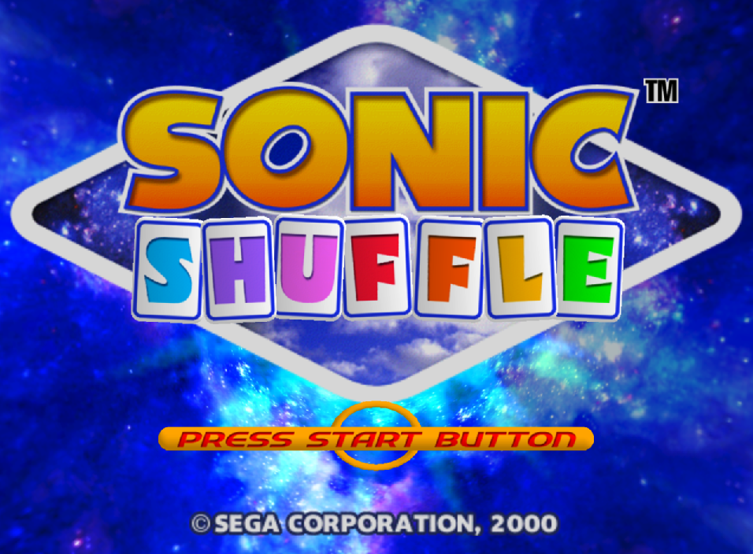
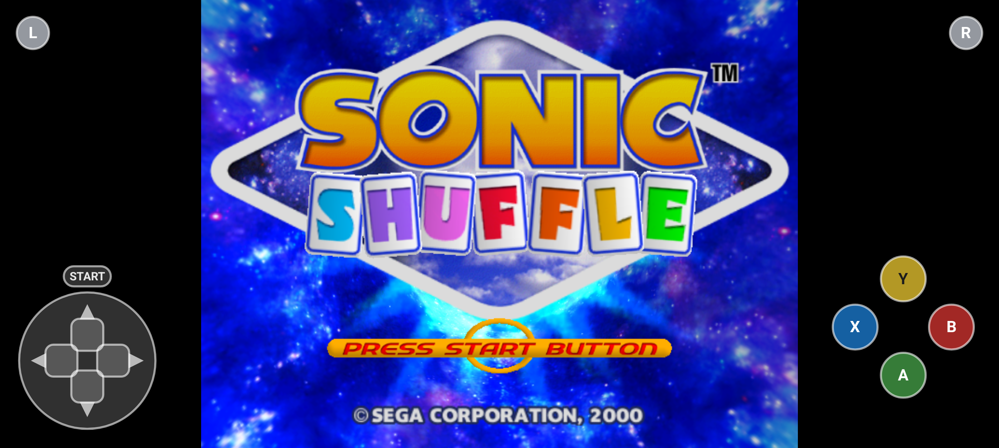
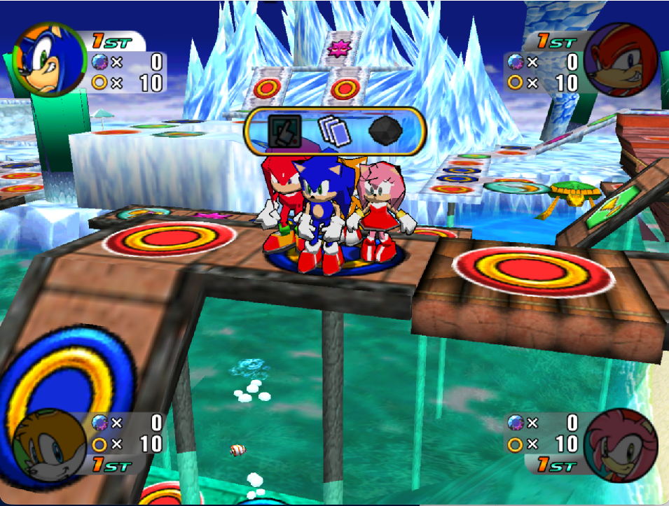
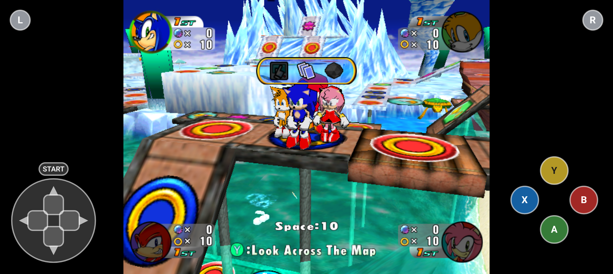

# Sonic Shuffle — Recompiled


**Sonic Shuffle recompiled for macOS Apple Silicon, Windows x64 and Android arm64.**

[](#supported-platforms)
[](#legal)
[](LICENSE)

[Supported platforms](#supported-platforms) · [Screenshots](#screenshots) · [What you need](#what-you-need) · [macOS](#macos) · [Windows](#windows) · [Android](#android) · [How it works](#how-it-works) · [FAQ](#faq)

**Sonic Shuffle Recompiled** is a native port of **Sonic Shuffle** built with
[dreamcomp](https://github.com/danielgomesvieira2000/dreamcomp). The original Dreamcast code is
recompiled ahead of time and runs through a native SDL3/Vulkan runtime. This is not an emulator
and it does not use Wine or Rosetta on macOS.

> **Bring your own game.** No disc image or extracted game data is included in the releases. Use
> only an image you legally own. The desktop launchers accept CHD, GDI, CUE and CDI images; the
> Android launcher accepts CHD, GDI and CUE.

## Supported platforms

| Platform | Status | Launcher | Graphics | Input | Verification device |
| --- | --- | --- | --- | --- | --- |
| **macOS** Apple Silicon | ✅ Playable | PyQt6 desktop launcher | SDL3 · Vulkan · MoltenVK | Keyboard, gamepad | Apple M4 Max |
| **Windows** x64 | ✅ Playable | PyQt6 standalone launcher | SDL3 · Vulkan | Keyboard, gamepad | ASUS ROG Ally |
| **Android** arm64-v8a | ✅ Playable | Built-in Android launcher | SDL3 · Vulkan | Touch controls, gamepad | Samsung Galaxy S25 Ultra |
| **Linux** | 🕓 Planned | — | — | — | — |

The macOS, Windows and Android ports use the same recompiled game code and the same game data
layout. Saves and settings are stored locally on each device.

## Screenshots

### Launcher

| macOS / Windows | Android |
| --- | --- |
| [](docs/images/launcher-desktop.png) | [](docs/images/launcher-android.png) |

### In game

| macOS / Windows | Android |
| --- | --- |
| [](docs/images/game-desktop.png) | [](docs/images/game-android.png) |

The desktop screenshots represent the shared macOS and Windows launcher and game experience.
Android screenshots were supplied from the tested Android build.

## What you need

| File | What it is |
| --- | --- |
| `Sonic Shuffle` disc image | Your legally obtained Dreamcast game image in CHD, GDI, CUE or CDI format |

The release packages contain the native executable, launcher, runtime libraries and tools, but no
disc image. The original image is read locally and is never uploaded or modified.

## macOS

### Requirements

- Apple Silicon Mac, such as an M1 or newer;
- macOS 13 or newer;
- a working Vulkan-capable system through the bundled MoltenVK runtime;
- approximately 300 MB for the unpacked application, plus space for your image.

### Install and play

1. Open `Sonic Shuffle Recompiled.dmg`.
2. Drag `Sonic Shuffle Recompiled.app` to Applications.
3. Open the app. If macOS shows a Gatekeeper warning for the ad-hoc build, use
   **right-click → Open** once.
4. Select your CHD, GDI, CUE or CDI image and press **Prepare image**.
5. Press **Launch Game**.

The launcher remembers the selected image. Once an image has been selected and prepared, it is
restored automatically on the next launch; you do not need to select it again. Use **Browse** to
replace it with another image.

The macOS release includes SDL3, the Vulkan loader, MoltenVK, its ICD file and the native `cdirip`
helper inside the app bundle. It does not require Homebrew, Wine or Rosetta.

### Recommended settings

- Resolution scale: **1x** or **2x**;
- Frame interpolation: **Off** for the best performance;
- use **Fast preset** for 1x resolution and interpolation disabled.

Logs are stored in `~/Library/Application Support/SonicShuffle/logs`.

## Windows

### Requirements

- Windows x64;
- a Vulkan-capable GPU and current graphics driver;
- your legally obtained CHD, GDI, CUE or CDI image.

### Install and play

1. Download and extract `Sonic Shuffle Recompiled Windows x64.zip`.
2. Start `SonicShuffleLauncher.exe`.
3. Select your disc image and press **Prepare image**.
4. Press **Launch Game**.

The launcher remembers the selected image. After the first selection, the image is restored when
the launcher starts again, so it does not need to be selected repeatedly. **Browse** can be used
to choose a different image.

The Windows release contains the standalone PyQt6 launcher, native game executable, SDL3, the
Vulkan runtime dependencies, `cdirip` and their licenses. It does not contain a disc image or
extracted game data.

Logs are stored in `%LOCALAPPDATA%\SonicShuffle\logs`.

The Windows port was tested on an **ASUS ROG Ally**. The release is x64 and requires a working
Vulkan window surface; virtual machines without one are not supported.

## Android

The Android port is an arm64-v8a APK with a built-in launcher. The launcher has one job: select
your game image once, then launch the game. A CHD, GDI or CUE image is copied into the app's
private storage and is not bundled in the APK.

### Requirements

- Android 10 or newer;
- arm64-v8a device;
- enough free storage for the selected game image.

### First launch

1. Install the APK.
2. Select your CHD, GDI or CUE image when prompted.
3. Wait for the image to be copied into the app's private storage.
4. Press **Launch Game**.

The Android launcher remembers the copied image in its private `iso` directory. On later launches
it finds the existing image automatically and does not ask you to select it again. Selecting a new
image replaces the previous choice.

The Android port is intended for arm64 devices and was prepared for use on a **Samsung Galaxy S25
Ultra**. Touch controls and external gamepads are supported.

### Saves and reinstall

The VMU save lives in the app's private files directory:

```text
Android/data/dev.ch1ppy.sonicshuffle/files/saves/sonicshuffle.vmu
```

Installing an updated APK over the existing app, including `adb install -r`, keeps app data by
design, so the save remains. Use **Android Settings → Apps → Sonic Shuffle → Storage → Clear
storage**, or uninstall the app, to remove it. Clearing storage also removes the copied game
image, so the launcher will ask for it once again.

## Controls and settings

The desktop launchers provide:

- keyboard and gamepad rebinding;
- controller deadzone and trigger-ramp settings;
- resolution scale;
- fullscreen/windowed mode;
- volume;
- aspect ratio;
- frame interpolation;
- live logs and launch diagnostics.

Android provides touch controls and gamepad input through SDL3.

## How it works

1. **Your image** — the disc image remains on your device and is never uploaded.
2. **Prepare** — the launcher validates CHD, GDI, CUE or CDI input. CDI images are converted once
   with the bundled native `cdirip` helper and cached locally.
3. **Recompile** — the original Dreamcast code is translated ahead of time into native C/C++.
4. **Build** — the generated code is compiled with the SDL3/Vulkan runtime for each platform.
5. **Play** — the result runs as a native macOS app, Windows executable or Android APK.

## Building from source

The desktop launcher uses Python 3 and PyQt6. Native game builds use CMake and Ninja.

```sh
python3 dreamcomp/tools/dc.py setup . --disc "/path/to/Sonic Shuffle.chd"
cmake -S . -B build -G Ninja -DCMAKE_BUILD_TYPE=Release \
  -DDREAM_RENDERER=ON -DDREAMCOMP_FRONTEND=OFF
cmake --build build --parallel
python3 -m pip install -r launcher/requirements.txt
python3 launcher/launcher.py
```

Platform packaging scripts are in `scripts/` and `android/scripts/`:

```sh
./scripts/package-macos-app.sh
./scripts/package-launcher-macos.sh
android/scripts/build_android.sh
```

The Android build requires Android SDK Platform 35, NDK `28.2.13676358`, CMake `3.31.6` and JDK
17. The Android APK is arm64-v8a only.

## Troubleshooting

| Problem | Fix |
| --- | --- |
| The image is requested again | Keep the image in the location selected by the launcher, or select it once more with **Browse**. Android copies it into private storage automatically. |
| Launch is disabled | Select a supported CHD, GDI, CUE or CDI image and press **Prepare image**. |
| Vulkan is missing | Install or update the GPU driver. A VM must expose a Vulkan window surface. |
| CDI preparation fails | Make sure the release includes the platform-native `cdirip` helper and that the CDI is a valid image. |
| macOS says the app cannot be opened | Use **right-click → Open** once for the ad-hoc signed build. |
| The game is slow | Use 1x scale and disable frame interpolation with **Fast preset**. |
| The game closes immediately | Open the Logs tab and attach the latest log when reporting the issue. |

## FAQ

**Does the release include the game image?** No. You must provide your own legally obtained image.

**Do I need to choose the image every time?** No. The launcher saves the selected image. After it
has been prepared once, it is restored automatically on the next launch.

**Is this an emulator?** No. The game code is recompiled ahead of time and runs natively with SDL3
and Vulkan.

**Is Linux supported?** Not yet. A Linux port is planned for a later stage.

**Does macOS use Wine or Rosetta?** No. The macOS release is a native Apple Silicon build.

## Credits

- [dreamcomp](https://github.com/danielgomesvieira2000/dreamcomp) — Dreamcast static recompilation framework.
- [SDL3](https://github.com/libsdl-org/SDL) — windowing, input and audio platform layer.
- [MoltenVK](https://github.com/KhronosGroup/MoltenVK) — Vulkan implementation on macOS.
- [cdirip](https://github.com/jozip/cdirip) — CDI conversion helper by DeXT / Lawrence Williams.

See `THIRD_PARTY_NOTICES.md` and the accompanying license files for full component terms.

## Legal

Sonic Shuffle and its original assets are property of their respective rights holders. This
independent project is not affiliated with or endorsed by Sega, the original developers or any
other rights holder.

No disc images, extracted game data or other copyrighted game assets are included in this
repository or in the clean platform releases. Use only files you are legally entitled to use.

## License

GPL-2.0. See [LICENSE](LICENSE) and the notices in `dreamcomp/`.
